## Hi 👋

**AI Engineer | AI Agent & Developer Tooling**

`TypeScript` · `AI Agents` · `RAG / MCP` · `Development Automation`

Building AI-powered developer tools and workflows that solve real engineering problems.

## Main Stack

`LLM API` · `RAG` · `MCP` · `Tool Calling` · `BM25` · `Embeddings`

## AI Engineering

- **AI Agent Systems** — RAG, MCP, Tool Calling, Agent Workflows
- **Retrieval & Evaluation** — Hybrid Search, Reranking, Token Profiling
- **Agent Reliability** — Hooks, Human-in-the-Loop, Feedback Logging
- **Developer Productivity** — Workflow Automation, Internal Tools, AI Tooling

## AI Development Tools

`Claude Code` · `Codex CLI` · `Agentic Development`

## Engineering Background

`HTML5 Canvas` · `CreateJS` · `Android WebView` · `C++` · `C#`

## Projects & Impact

- **AI Factory** — RAG/MCP-based development environment with agent workflow evaluation
- **Whisper AI Editor** — Reduced repetitive editing time by approximately 80%
- **Deployment Automation** — Automated repetitive build and FTP deployment workflows
- **Game Development** — Interactive content development and Roblox game releases

## Currently Working On

`AI Agent Reliability` · `RAG Evaluation` · `Developer Productivity`

